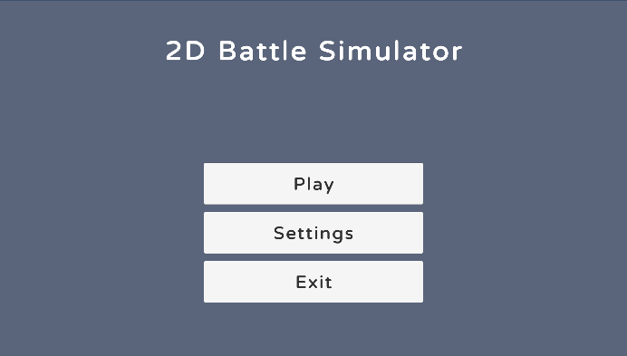
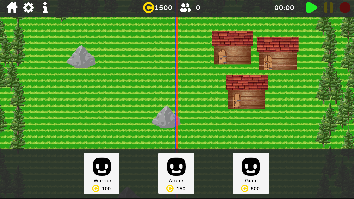
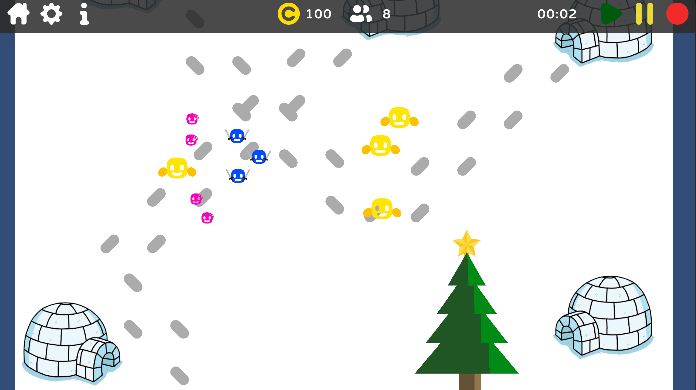

# 2D Battle Simulator for CS4096 Project

A 2D top-down RTS battle simulator created using Unity 6.6. Our main inspiration was *Totally Accurate Battle Simulator (TABS)*. In the game the player can place an army and command it against an enemy AI commanders army. The game has four maps to choose from (Village, Desert, Bridge and Snowland) and three units to choose from (Warrior, Archer and Giant).

***

## Team

| Name | Email |
|---|---|
| Ciarán Fernandez Walshe | 24405094@studentmail.ul.ie |
| Daniel Tianhao Wu  | 24405701@studentmail.ul.ie |

***

## Controls

### Before Battle

| Input | Action |
|---|---|
| Left Mouse Button | Place selected unit |
| Right Mouse Button | Remove highlighted unit |
| C | Clear all placed units |
| Mouse Scroll Wheel | Zoom camera |
| WASD / Arrow Keys | Move camera |

### During Battle

| Input | Action |
|---|---|
| Left Mouse Button | Select highlighted unit |
| SHIFT + Left Mouse Button | Add highlighted unit to selection |
| Left Mouse Button + DRAG | Select multiple units using selection box |
| SHIFT + Left Mouse Button + DRAG | Add multiple units using selection box to selection |
| Mouse Scroll Wheel | Zoom camera |
| WASD / Arrow Keys | Move camera |
| C + Mouse Pointing at enemy | All selected unit attack selected enemy unit |
| X | All selected unit hold position |
| Z | All selected unit cancel all commands |

***

## Screenshots

### Main Menu

### Before Battle

### During Battle

***

## Tools and Software Used

- **Game Engine:** Unity 6.6
- **Programming Language:** C#
- **Version Control:** Git and GitHub
